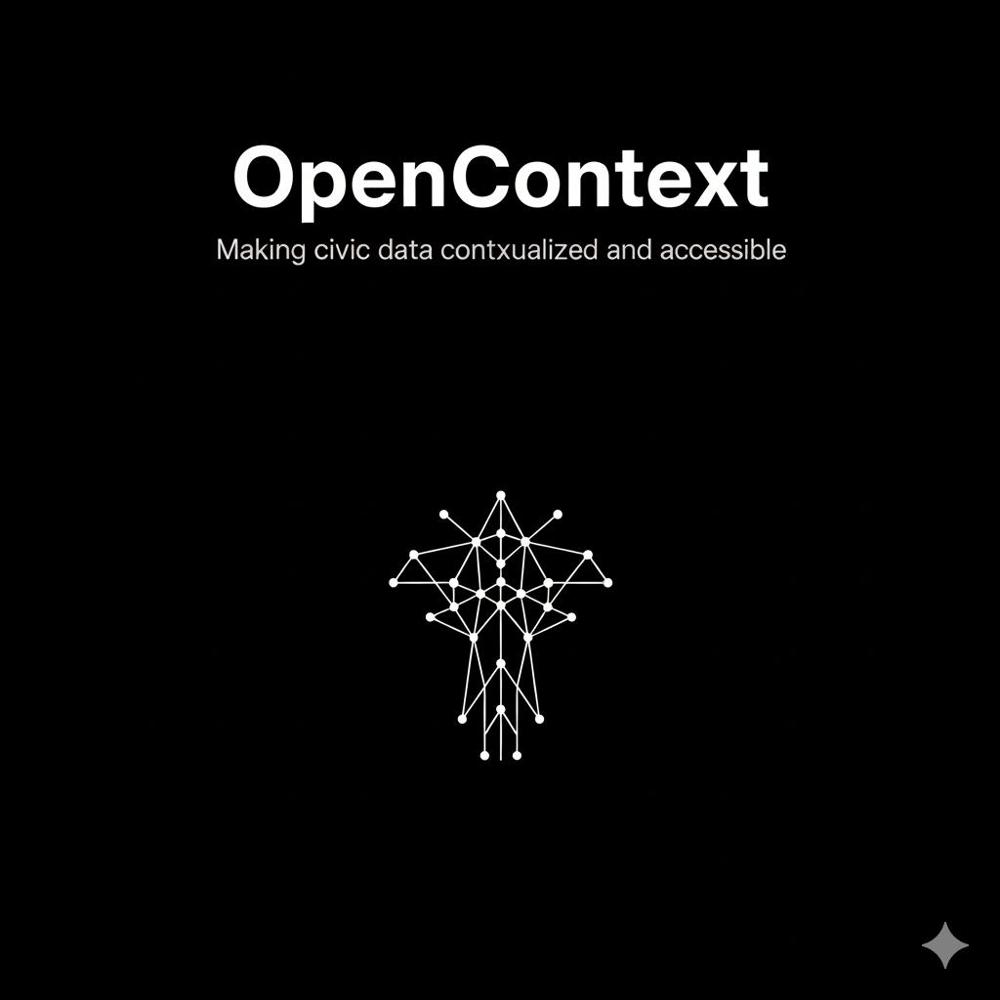

# OpenContext

<p align="center">
  
</p>

[](https://opensource.org/licenses/MIT)
[](https://www.python.org/downloads/)
[](https://modelcontextprotocol.io/)

OpenContext connects AI assistants such as Claude to public open data. It is a [Model Context Protocol](https://modelcontextprotocol.io/) (MCP) server for a government open data portal: point it at your portal, deploy it to AWS Lambda or Google Cloud Functions, and add it to Claude as a connector. Residents, analysts and staff can then search the catalog, read dataset metadata and query the data in plain language, with answers that link back to the source datasets.

---

## Supported portals

Each deployment serves one portal through one plugin. Tool names carry the plugin prefix, e.g. `ckan__search_datasets`.

| Portal software | Example portals | Plugin | Tools |
| --- | --- | --- | --- |
| CKAN | Boston, data.gov, data.gov.uk | `ckan` | `search_datasets`, `list_datasets`, `get_catalog_stats`, `get_dataset`, `get_schema`, `query_data`, `aggregate_data`, `execute_sql` |
| ArcGIS Hub | Washington DC, HUD, hub.arcgis.com | `arcgis` | `search_datasets`, `get_aggregations`, `get_dataset`, `get_schema`, `query_data`, `aggregate_data` |
| Socrata | Chicago, NYC, San Francisco | `socrata` | `search_datasets`, `list_categories`, `get_dataset`, `get_schema`, `query_dataset`, `execute_sql` |
| Opendatasoft | Long Beach, public.opendatasoft.com | `opendatasoft` | `search_datasets`, `list_categories`, `get_dataset`, `get_schema`, `query_data`, `aggregate_data` |
| Anything else | Any API or database | your own | See [Custom Plugins](docs/CUSTOM_PLUGINS.md) |

Arguments and portal-specific notes for every tool are in [Built-in Plugins](docs/BUILT_IN_PLUGINS.md).

## How it works

- **One fork, one server.** Each fork of this repository enables exactly one plugin in `config.yaml` and becomes one MCP server. Run several forks to serve several portals.
- **Read-only.** Every tool reads public data; queries are checked by provider-specific validators (SQL, SoQL, ODSQL, ArcGIS WHERE) before they leave the server, and outbound requests go only to the configured portal and hosts you list as trusted.
- **Portal content is treated as untrusted.** Titles, descriptions and field values are framed as data, not instructions, to blunt prompt injection. See [Security](docs/SECURITY.md).
- **Serverless.** Terraform provisions API Gateway + Lambda on AWS, or Cloud Functions gen2 on GCP. See [Architecture](docs/ARCHITECTURE.md) and [Deployment](docs/DEPLOYMENT.md).

---

## Quick Start

Install [uv](https://docs.astral.sh/uv/getting-started/installation/) first, then:

```bash
# 0. Fork https://github.com/sgarcese/OpenContext, then clone your fork
git clone https://github.com/<you>/OpenContext.git
cd OpenContext
uv sync --extra cli

# 1. Check prerequisites (Python 3.11+, uv, AWS CLI, Terraform)
uv run opencontext authenticate

# 2. Configure interactively (creates config.yaml + Terraform workspace)
uv run opencontext configure
# or for GCP -- you must have a GCP project; you will be prompted for its ID
uv run opencontext configure --cloud gcp

# 3. Deploy
uv run opencontext deploy --env staging
# or for GCP:
uv run opencontext deploy --cloud gcp --env staging
```

Connect via **Claude Connectors** (same steps on Claude.ai and Claude Desktop):

1. Go to **Settings** → **Connectors** (or **Customize** → **Connectors** on claude.ai)
2. Click **Add custom connector**
3. Enter a name (e.g. "Your City OpenData") and the URL printed at the end of `opencontext deploy`

See [Quick Start](docs/QUICKSTART.md) for the five-minute version and [Getting Started](docs/GETTING_STARTED.md) for the full walkthrough.

### Try it locally first

No cloud account is needed to try a portal:

```bash
cp config-example.yaml config.yaml   # enable one plugin and set its portal URL
uv run opencontext serve             # serves http://localhost:8000/mcp
uv run opencontext test --url http://localhost:8000/mcp
```

[Testing](docs/TESTING.md) shows how to connect Claude or the MCP Inspector to the local server.

---

## Using uv and `requirements.txt`

- **Default workflow:** `uv sync --extra cli` (or `uv sync --all-extras` for development) installs from `pyproject.toml` and the lockfile into `.venv`. Run CLI and tools with `uv run …` when you want to use the project environment without activating the venv.
- **`requirements.txt`** is kept for **Lambda packaging** (`opencontext deploy` installs with `uv pip install … -r requirements.txt`) and **security scans** in CI (e.g. `uv run pip-audit -r requirements.txt`). You usually do not install from `requirements.txt` by hand unless debugging those flows.

Details: [Getting Started — full walkthrough](docs/GETTING_STARTED.md) (section *Using uv with requirements.txt*).

---

## Documentation

| Doc | Description |
| --- | --- |
| [Quick Start](docs/QUICKSTART.md) | Fork, configure and deploy in five minutes |
| [Getting Started](docs/GETTING_STARTED.md) | Full setup and usage |
| [CLI Reference](docs/CLI.md) | All CLI commands and flags |
| [Architecture](docs/ARCHITECTURE.md) | System design and plugins |
| [Built-in Plugins](docs/BUILT_IN_PLUGINS.md) | CKAN, ArcGIS Hub, Socrata, Opendatasoft tools and configuration |
| [Custom Plugins](docs/CUSTOM_PLUGINS.md) | How to write your own plugin |
| [Deployment](docs/DEPLOYMENT.md) | AWS & GCP (`--cloud`), Terraform, monitoring |
| [Testing](docs/TESTING.md) | Local testing (Terminal, Claude, MCP Inspector) |
| [Security](docs/SECURITY.md) | Threat model, prompt-injection guardrails |
| [FAQ](docs/FAQ.md) | Common questions |

---

## Contributing

Issues and pull requests are welcome at [sgarcese/OpenContext](https://github.com/sgarcese/OpenContext).

```bash
uv sync --all-extras          # CLI, dev and test dependencies, including pre-commit
uv run pre-commit install     # Ruff, yamllint, gofmt on each commit

# What CI runs
uv run ruff check core/ plugins/ server/ tests/
uv run ruff format --check core/ plugins/ server/ tests/
uv run pytest tests/ -n auto --cov=core --cov=plugins --cov-fail-under=80
```

CI also runs `pip-audit`, Terraform fmt/validate, tflint and tfsec. New code needs tests: the coverage gate is 80%. To add a data source, start from [Custom Plugins](docs/CUSTOM_PLUGINS.md).

---

## Credits

OpenContext was created by **Srihari Raman**, its original author.

This version is maintained by **Santiago Garces Escobar** ([@sgarcese](https://github.com/sgarcese)), who added the shared plugin layer, the Opendatasoft plugin, the security guardrails and the catalog and ArcGIS improvements.

With thanks to the **Burnes Center for Social Impact at Northeastern University** and **GovEx, the Center for Government Excellence at Johns Hopkins University**.

The project began at [thealphacubicle/OpenContext](https://github.com/thealphacubicle/OpenContext); the City of Boston runs its own deployment from [CityOfBoston/OpenContext](https://github.com/CityOfBoston/OpenContext). Work from this repository is offered back to both.

## License

MIT — see [LICENSE](LICENSE).
